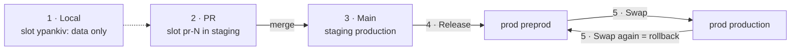

# How code gets from your machine to production (simulated)

Same flows as the real proposal; "Azure" is the `_azure_` branch, served by GitHub Pages at
`https://<owner>.github.io/<repo>/`.



## What do I run?

| I want to… | Run | Inputs |
|---|---|---|
| get data to develop against locally | **1 · Local** | `name` (e.g. `ypankiv`), `action: up` |
| start my local data over, empty | **1 · Local** | `name`, `action: refresh` |
| delete my local data | **1 · Local** | `name`, `action: down` |
| see a PR running | nothing: open the PR | — |
| update staging | nothing: merge the PR | — |
| put a version on preprod | **4 · Release** | `ref` (default `main`) |
| make it live | **5 · Swap** | — |
| roll back | **5 · Swap** again | — |
| ship a hotfix | branch `hotfix/…` from the latest `prod-*` tag, merge the fix into it, **4 · Release** with `ref: hotfix/…`, **5 · Swap**; then cherry-pick the fix into main | |
| change infrastructure | **9 · Infra** (read the summary), then again with `apply` | `env` |

## Two words

| Word | Means | Here |
|---|---|---|
| **environment** | a resource group | folder `staging/` or `prod/` on `_azure_` |
| **slot** | one running copy of the apps plus its own data | folder `<env>/slots/<slot>/`, data files ending in `--<slot>` |

## Where things are

```
workflows/   what you run, one file per row of the table above
actions/     how it works
  build/api  build/web  build/worker
  deploy
  slot/up  slot/down
  swap
  shopify
  release-check
  azure/save      the simulation's stand-in for Azure: commit and push _azure_
```

Every workflow starts with three lines: **WHEN** it runs, what it **DOES**, what it can **NEVER** do.
